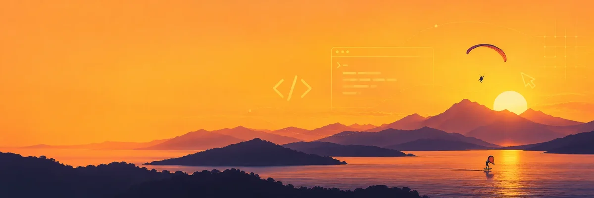

I enjoy making things and spending time outdoors. I like exploring new ideas, learning as I go, and finding a little space to slow down.

**Currently working on**

- **Spliit Cloud** — open-source expense sharing. [GitHub](https://github.com/antonio-ivanovski/spliit-cloud) · [Public instance](https://spliit.cloud)
- **Radosnica** — a private baby memory book, *work in progress*. [Website](https://radosnica.mk)

Open to the right full-stack engineering opportunity.

**Your next teammate? Let’s find out.**

Share the role you have in mind for an AI-assisted review of how it fits my experience.

[Explore the fit →](https://antonio.mk/fit-check/)

[antonio.mk](https://antonio.mk) · [Let’s talk](mailto:me@antonio.mk)
